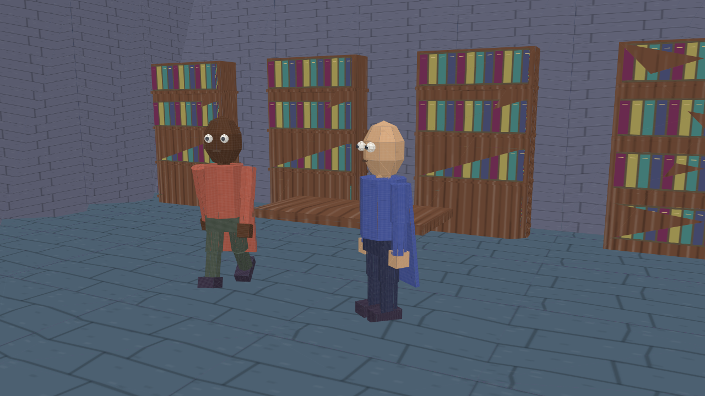

# Your first cartoon: A First Hello

**Goal:** make a short two-scene cartoon, add synthetic narration and music, then save both an editable project and a movie. This tutorial uses only generic characters and a library set. Expect about 15–30 minutes, plus your first installation/download.



*Software-rendered still from the included tutorial, not a screenshot of the editor.*

## 1. Get the project

On the repository's GitHub page, choose **Code → Download ZIP**, then extract the whole ZIP. Do not work inside the ZIP preview. Alternatively, clone the repository if you already use Git.

You need Node.js **20 or newer**, including npm. Use the official Node.js installer for your operating system if it is not installed. A desktop browser is recommended; a phone is not the intended build/authoring environment. FFmpeg is optional unless you want the headless movie renderer.

## 2. Build the offline app

Open Terminal (macOS/Linux) or PowerShell/Terminal (Windows). Change into the extracted directory that contains `package.json`. For example, replace the example path below with your actual folder path:

```sh
cd "path/to/3D-Cartoon-Studio-main"
node --version
npm --version
npm ci
npm run build
```

The first installation needs the internet. A successful build prints “Built START.html.” It creates:

- `START.html`: the single-file offline browser app.
- `Demo.jetcartoon.json`: the standard starter with embedded music.
- `First-Cartoon.jetcartoon.json`: the tutorial project with embedded music.
- `engine.bundle.js` and `voice.bundle.js`: generated runtime files used by the CLI.

After installation and building, authoring/rendering does not require an AI service, account, API key or ongoing network connection. Keep this source folder intact if you want the Node commands too.

## 3. Open the tutorial

Double-click `START.html` to open it in a desktop browser. Wait until the status says **Ready**. Under **Projects & export**, choose **Load project** and select the generated `First-Cartoon.jetcartoon.json`.

Do not load `examples/first-cartoon.json` for this step: it is the small source blueprint without embedded music. The build creates the complete portable copy at the root.

You should see two scenes in the scene selector:

1. **Arrival:** a traveler approaches a scholar in the library.
2. **A friendly answer:** the scholar gestures while answering.

Press **Play**. Use the timeline slider to inspect a moment. The initial project has music but no spoken narration yet.

## 4. Make one small edit

Choose **Arrival** in the scene selector. Replace **Complete narration / caption** with:

> A traveler enters the library, looking for the beginning of an adventure.

Click **Apply scene changes**. Check the status for errors before continuing. The caption should change in the preview. If you edit any scene field, apply the change before moving to another scene.

The actors, props, shots and effects fields contain JSON. You do not need to change those for this first pass. See [Recipes](RECIPES.md) when you want to try a camera or movement change.

## 5. Add narration and choose music

For each scene:

1. Choose a **Voice preset**. Start with `narrator` or `warm`.
2. Click **Hear voice sample** to hear the preset.
3. Click **Generate scene speech** and wait for the generated-and-stored message.
4. The scene duration may increase to fit the speech. Preview the whole scene after generation.
5. Choose **Music**: `Tranquility`, `Suspense`, `Determination`, `Playfulness`, or `Silence`. Click **Apply scene changes** after changing it.
6. Press **Play**, then adjust the voice/music sliders so the words remain clear.

The tutorial already embeds all four tracks. They are original emotion-based music by Nicholas Alexander Benson (Jet Black). The voices are traditional local synthetic speech, not cloned or cloud-generated voices.

Changing narration text invalidates its old generated speech. Generate it again after changing the caption. Imported dialogue is also supported with **Use an existing dialogue recording**; set scene duration to fit the imported audio yourself.

**Important:** preview volume sliders do not control the fixed export mix in this version. Listen to the exported movie. Browser and headless audio mixing differ; see [Troubleshooting](TROUBLESHOOTING.md).

## 6. Save before recording

Click **Save portable project**. The browser downloads `Jet-Cartoon-Project.json`; rename it to something recognizable, such as `My-First-Cartoon.json`.

This JSON is the editable master, including embedded audio. A video is not an editable project. There is no autosave: save again after important changes and before closing/reloading the tab.

## 7. Export a movie

Under **Movie scene range (zero-based)**, enter `0` and `1` for the two tutorial scenes. Click **Record movie** and keep the tab visible until it finishes. Let your browser save the download.

The output is MP4 if the browser supports it, otherwise WebM. A 20-second project records in about 20 seconds, not instantaneously. Do not close or background the tab while recording.

Open the downloaded video outside the studio. Check:

- Both scenes appear in the correct order.
- Narration and music are audible and balanced.
- The final words and last scene are not cut off.
- Captions are readable and no important action is hidden.

If recording is unsupported or inconsistent, use the Node + FFmpeg route in [Recipes](RECIPES.md). It produces separate scene MP4s, not an automatically assembled finished film.

## 8. Make a still or comic next

Pause at an interesting moment. Under **Fresh stills**, choose **Copy current scene**, then **Preview fresh still** or **Download high-resolution PNG**. This creates a fresh render, not a scaled preview screenshot.

Under **Comic pages**, choose **New comic from current frame**. Select a page layout, add panels, and save both the editable comic and its PDF. Follow the complete [comic recipe](RECIPES.md#make-a-two-panel-comic) before building a longer issue.

You have finished the first tutorial when you have an editable project JSON and a movie you have watched and heard. Keep both. Continue with [Recipes](RECIPES.md), [Project format](PROJECT_FORMAT.md), or [Troubleshooting](TROUBLESHOOTING.md).
